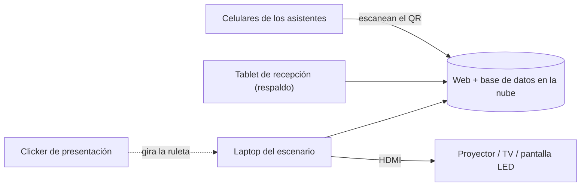

# Addiuva · Ruleta del Sorteo de Fin de Año — Plan

Evento: unas 100 personas · check-in con QR al llegar · ruleta digital en pantalla gigante · cada persona participa una sola vez.

---

## 1. ¿App o web?

| | **Web (recomendado)** | App nativa (iOS / Android) |
|---|---|---|
| Instalación para los asistentes | Ninguna: escanean el QR y se abre el navegador | Descargar desde la tienda (fricción en la puerta) |
| Publicación | Inmediata (Vercel / Netlify) | Revisión de Apple/Google (días), cuentas de desarrollador (USD 99/año en Apple) |
| Funciona en | Cualquier celular, tablet, laptop o Smart TV con navegador | Solo en los dispositivos donde se instale |
| Costo / tiempo | Bajo, 1–2 semanas | Alto, 4–8 semanas |
| Cuándo conviene | Eventos puntuales | Si van a usarla todo el año (beneficios, encuestas, etc.) |

**Conclusión:** una **web responsive (PWA)**. La misma web tiene 3 pantallas:

1. **Pantalla gigante** (`/pantalla`): ruleta, QR, contador y premios.
2. **Check-in** (`/checkin`): lo que ve cada persona en su celular.
3. **Recepción / Admin** (`/admin`, con contraseña): check-in manual, premios y configuración.

---

## 2. Cómo se evita que alguien participe dos veces

Combinamos varias capas, de la más simple a la más estricta:

| Capa | Qué frena | Incluida en el prototipo |
|---|---|---|
| **Lista cerrada de invitados** (Excel de RR.HH. con legajo) | Gente fuera de la lista y nombres inventados | ✅ |
| **1 legajo = 1 número** (en producción: clave única en la base de datos) | Registrarse dos veces: el segundo intento muestra el mismo número | ✅ |
| **Pantalla “¿Sos vos?”** con nombre y área | Equivocarse de legajo y registrar a otra persona | ✅ |
| **PIN del evento**, que solo aparece en la pantalla del salón y se puede rotar | Que alguien que no vino se registre con el link que le pasaron por WhatsApp | ✅ |
| **Contador de intentos duplicados** en el panel | Da visibilidad a RR.HH. | ✅ |
| **Ganador que no está → “girar de nuevo”** | Que salga alguien que se fue temprano | ✅ |
| Quitar ganadores de la ruleta | Que alguien gane dos premios | ✅ (opcional) |
| *Opcional:* últimos 4 dígitos del DNI además del legajo | Que alguien registre a un compañero ausente sabiendo su legajo | Fase 2 |
| *Opcional:* login con cuenta corporativa (Microsoft 365 / Google) | Suplantación de identidad, con verificación fuerte | Fase 2 (agrega fricción) |
| *Opcional:* QR personal de un solo uso enviado por mail | Igual que el anterior, sin login | Fase 2 |

> [!TIP]
> Para 100 compañeros de trabajo, **legajo + PIN del salón + “¿Sos vos?”** es la combinación con mejor equilibrio: sale en menos de 20 segundos por persona y bloquea los casos reales (duplicados y gente que no vino).

---

## 3. Hardware: qué se necesita



| Rol | Opción recomendada | Alternativas | ¿Hace falta pantalla táctil? |
|---|---|---|---|
| **Pantalla gigante** | Cualquier **laptop** con Chrome/Edge conectada por **HDMI** al proyector o TV | Mini-PC, Smart TV con navegador (menos fluida), Chromecast/Fire TV (no recomendado) | **No.** Se gira con barra espaciadora, clic o un **clicker de presentación** (ej. Logitech R400, unos USD 30), así el presentador puede girarla desde el escenario |
| **Check-in** | **El celular de cada asistente** (cámara nativa, sin app) | — | — |
| **Recepción (respaldo)** | 1 **tablet** de 10–11": iPad 10.ª gen, Samsung Galaxy Tab A9+ o Lenovo Tab M11 (USD 200–350) | Cualquier laptop o celular de RR.HH. | La tablet ya es táctil. **No hace falta laptop táctil** |
| **Internet** | Wi-Fi del salón | **Respaldo:** hotspot 4G/5G desde un celular (100 check-ins consumen muy pocos datos) | — |
| **Cartelería** | QR impreso en la entrada y en las mesas + QR en la pantalla gigante | Credencial o tarjeta en cada mesa | — |

> [!NOTE]
> Una laptop táctil solo sirve si quieren que alguien gire la ruleta tocando la pantalla en el escenario. Con un clicker o el teclado se logra lo mismo y es más confiable frente al público.

**Modo kiosco (opcional):** en la tablet de recepción, activar *Acceso guiado* (iPad) o *Fijar pantalla* (Android) para que solo muestre la web.

---

## 4. Opciones de arquitectura para producción

| Opción | Cómo funciona | Pros | Contras | Costo |
|---|---|---|---|---|
| **A. Web + Supabase** ⭐ | Front estático (Vercel) + Postgres con *Realtime* | Tiempo real nativo, restricción `UNIQUE(legajo)` en la base, panel para ver datos, plan gratuito | Requiere internet en el salón | USD 0 |
| B. Web + Firebase | Igual, con Firestore | Muy conocido, tiempo real | Las reglas de seguridad son menos intuitivas | USD 0 |
| C. 100 % local | La laptop corre un servidor y los celulares se conectan al Wi-Fi local | Funciona sin internet | Hay que conectar a todos al mismo Wi-Fi: fricción y riesgo | USD 0 |
| D. Sin código | Google/Microsoft Forms → planilla → wheelofnames | Rápido | Sin anti-duplicado en tiempo real, carga manual y menos imagen de marca | USD 0 |

**Recomendación: opción A**, con la opción C como plan de contingencia (el prototipo actual ya corre 100 % offline en una laptop).

### Modelo de datos (Supabase)

```sql
create table colaboradores (
  legajo      text primary key,
  nombre      text not null,
  area        text,
  numero      int unique,          -- se asigna al hacer check-in
  checkin_at  timestamptz,
  origen      text,                -- 'qr' | 'recepcion'
  ausente     boolean default false
);
create table premios (
  id          uuid primary key default gen_random_uuid(),
  orden       int,
  nombre      text not null,
  ganador     text references colaboradores(legajo) unique
);
create table intentos (            -- auditoría de duplicados / PIN incorrecto
  id bigserial primary key, legajo text, resultado text, at timestamptz default now()
);
```

El check-in se hace con una **función RPC transaccional** que valida el PIN y asigna el número con `UPDATE … WHERE checkin_at IS NULL`. Aunque alguien toque “registrar” dos veces seguidas, es imposible duplicar.

### Sorteo transparente
- El ganador se elige con **aleatoriedad criptográfica** (`crypto.getRandomValues`). La animación solo lo muestra.
- Se guarda un **registro** (hora, premio, ganador) y se exporta a CSV para RR.HH.

---

## 5. Plan de trabajo

| Fase | Entregable | Duración estimada |
|---|---|---|
| 0 · Prototipo ✅ | Pantalla gigante + check-in + recepción, 100 % en el navegador (`prototipo/`) | Listo |
| 1 · Backend | Supabase: tablas, RPC de check-in, tiempo real y login del admin | 2–3 días |
| 2 · Producción | Rutas separadas `/pantalla`, `/checkin`, `/admin`, deploy en Vercel, dominio (ej. `sorteo.addiuva.com`) | 2 días |
| 3 · Datos reales | Importar el Excel de RR.HH., cargar los premios, generar QR imprimibles | 1 día |
| 4 · Ensayo | Prueba con 10–20 personas, prueba con el proyector del salón, plan B sin internet | 1 día |
| 5 · Evento | Operación en vivo + export de ganadores | Día D |

---

## 6. Checklist del día del evento
- [ ] Laptop cargada + cargador + adaptador HDMI (USB-C → HDMI si hace falta)
- [ ] Chrome en pantalla completa (`F`) y sonido conectado a los parlantes del salón
- [ ] Clicker con pilas
- [ ] Tablet de recepción cargada y logueada en `/admin`
- [ ] Hotspot 4G de respaldo probado
- [ ] QR impresos (entrada + mesas)
- [ ] PIN del evento definido (y rotarlo si se filtra)
- [ ] Lista de premios en el orden del sorteo (de menor a mayor)

---

## 7. Decisiones pendientes
1. ¿Usan **legajo**, **DNI** o **email corporativo** como identificador?
2. ¿Un ganador puede ganar más de un premio? (hoy: no, configurable)
3. ¿Supabase (recomendado) o Firebase?
4. ¿Tienen dominio propio para la web (ej. `sorteo.addiuva.com`) o usamos uno gratuito de Vercel?
